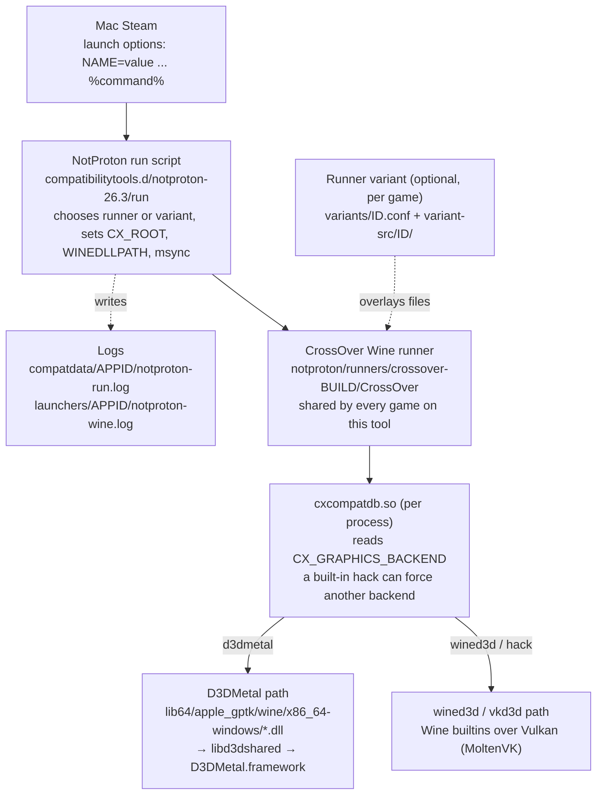

# How the stack works

Steam hands the launch to NotProton's run script, which picks a CrossOver runner and starts Wine. Inside Wine, **each process separately decides its graphics backend**, so a launcher and the game can end up on different ones.

## Key pieces

- **Launch options.** NotProton passes them through a shell like Linux Steam does. `NAME=value` before `%command%` becomes an environment variable; anything after `%command%` is a game argument.
- **NotProton calls Wine directly**, not CrossOver's `bin/wine` wrapper. So backend selection happens inside Wine, not in CrossOver's Perl launcher.
- **`cxcompatdb.so`** is CrossOver's per-executable hack database (compressed inside the `.so`). It reads `CX_GRAPHICS_BACKEND` but can force another backend, append command-line flags, or add DLL overrides for specific executables. It needs `CX_HOME` set, or it logs `couldn't get path to JSON database`.
- **D3DMetal path.** With `d3dmetal`, Wine prepends `<runner>/lib64/apple_gptk/wine` to the DLL search path. `d3d12.dll`, `d3d12core.dll`, `dxgi.dll`, `d3d11.dll` and friends there are thin Windows stubs whose Unix side is `libd3dshared.dylib`, which loads `D3DMetal.framework`.
- **wined3d / vkd3d path.** Wine's own D3D over Vulkan via MoltenVK. It does not handle modern DX12 games.

## Telling the paths apart in the Wine log

| Log line | Means |
| --- | --- |
| `set_graphics_backend using d3dmetal as the graphics backend` | That process is on D3DMetal (needs `trace+process`). |
| `applying hack "<name>": trying graphics backend wined3d` | CrossOver forced that exe off your choice (needs `trace+cxcompatdb`). |
| `wined3d_adapter_create Using the Vulkan renderer for d3d10/11` | That process is on wined3d. |
| `vkd3d: Cannot load DXIL conversion library` | That process tried DX12 through vkd3d, not D3DMetal. |
| `Unhandled exception code c0000409` | Fast-fail exit. Many games use it after showing a fatal error. |

## Where things live

All under `~/Library/Application Support/` unless noted.

| What | Where |
| --- | --- |
| Compat tool and run script | `Steam/compatibilitytools.d/notproton-26.3/run` |
| Base runner | `notproton/runners/crossover-26.3.0.39832/CrossOver` |
| GPTK DLLs and D3DMetal | `<runner>/lib64/apple_gptk/wine/` and `<runner>/lib64/apple_gptk/external/` |
| Variant descriptors and sources | `notproton/variants/*.conf`, `notproton/variant-src/` |
| Built variant runners | `notproton/runners/crossover-<build>+<variant>@<hash>/` |
| Wine prefix and run log | `Steam/steamapps/compatdata/<appid>/` |
| Per-game Wine log | `notproton/launchers/<appid>/notproton-wine.log` |
| NotProton's own log (launch commands) | `notproton/notproton.log` |
| Stock GPTK files | mounted DMG: `/Volumes/Evaluation environment for Windows games 4.0 beta 3/redist/` |

For a **non-Steam shortcut** (e.g. a game installed through the Epic or Rockstar launcher inside the prefix), `<appid>` is the shortcut's generated id, a large number, not the store's app id.
